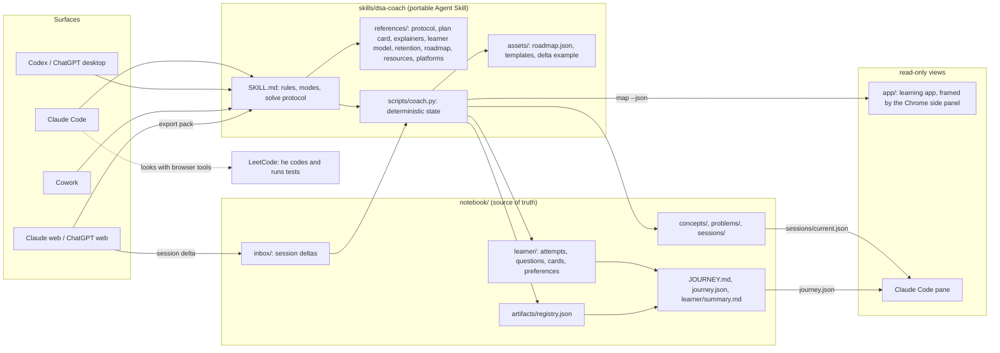

# Architecture

## Goals

1. Teach DSA so that skill shows up unaided, days later, under interview conditions, and train planning programs in your head.
2. Run on any agent platform (Claude Code, Cowork, Claude web, Codex, ChatGPT) without forking the logic.
3. Keep an honest, inspectable record of the journey: what was covered, what's retained, what's due, what works.
4. Be easy to refine: every rule, schedule and threshold lives in a file that can be changed, tested and versioned.

## Layers

| Layer | Owns | Changes when |
|---|---|---|
| Skill instructions (SKILL.md, references) | How to teach: rules, modes, stage gates, hint ladder, explainer rules, card-writing rules | Teaching behaviour needs to improve |
| Deterministic scripts (coach.py) | All state changes: IDs, schedules, statuses, ledger, snapshot, export/import, packaging | Data model or scheduling rules change |
| Data (assets/roadmap.json, templates) | The plan: patterns, tiers, weeks, cues, invariants, canonical problems | The plan changes |
| Notebook | Everything about the learner | Every session |
| Surfaces | Where sessions happen | Never touches the logic |
| Views (app, Chrome panel, pane) | Showing progress, theory and the live solve | They only read; changes go through coach.py |

The split is deliberate: the LLM teaches, the script keeps state. A model can misremember a date or invent a streak; the script can't.

## A session, end to end

1. **Start.** Claude Code's SessionStart hook (or the skill's first step elsewhere) runs `coach.py status`, which refreshes the snapshot and prints focus, due items and next steps.
2. **Teach.** The skill picks a mode (learn, solve, review, quiz, explain, mock, ai-drill, machine) and follows the stage gates and hint ladder.
3. **Record.** Each attempt, question, card and explainer goes through `coach.py`. In web chats the coach emits a session delta instead.
4. **Snapshot.** `coach.py snapshot` regenerates `JOURNEY.md` (for me), `journey.json` (for tools and future dashboards) and `learner/summary.md` (≤60 lines of context for the next session on any platform).

## Platform matrix

| Platform | Skill loading | Runs coach.py | Notebook access | Explainers |
|---|---|---|---|---|
| Claude Code | `.claude/skills/dsa-coach` (link) | Yes | Direct | HTML files, or published artifacts where available |
| Codex CLI / IDE | `.agents/skills/dsa-coach` (link) | Yes | Direct | HTML files |
| ChatGPT desktop | `~/.agents/skills` (after `install --user`) | If it can run scripts | Direct when it can | HTML files |
| Cowork | Project with this folder, or the uploaded zip | Yes | Direct | Published artifacts |
| Claude web | Uploaded zip | In the sandbox only | Export pack in, delta out | Published artifacts |
| ChatGPT web | No standalone skills (Oct 2026); paste or attach the pack | In a code interpreter only | Export pack in, delta out | Downloadable HTML |

## Design decisions

| Decision | Why | Trade-off |
|---|---|---|
| Files are the learner model, not platform memory | Inspectable, versionable, portable across vendors; memory profiles have been shown to increase sycophancy | Needs an export/import round trip on the web |
| Python standard library only | Runs anywhere Python 3.9+ exists, including sandboxes without network | No FSRS library yet; a simple ladder schedule instead |
| Credit techniques only on delayed, unaided outcomes | Immediate success and enjoyment are poor predictors of retention | The ledger fills slowly (weeks) |
| Symlinks into `.claude/skills` and `.agents/skills` | One canonical copy; edits are live in Claude Code and Codex | Fall back to `install --copy` if a tool ignores symlinks |
| A versioned delta format for web chats | One import path for every platform without file access | A manual save step after web sessions |
| Solve on LeetCode; the coach observes it with its own browser tools | No editor, runner or LeetCode-specific code to maintain; one coach, in the chat | Observation depends on the agent's tools; without them he pastes code and results |
| Learning app and panels are read-only views | One writer (`coach.py`), so the views can't drift from the notebook | Explainers are written in the chat from a prompt the page hands over |
| JOURNEY.md generated, never hand-edited | One source of truth; no drift between log and summary | Hand edits go into the logs, not the snapshot |

## Versioning

Semantic versions live in `metadata.version` (SKILL.md) and `SKILL_VERSION` (coach.py). Every attempt records the `skill_version` it was taught under, so later analysis can tell whether a change helped.

## Build roadmap

| Step | What | Status |
|---|---|---|
| 1. Core | Skill (rules, protocol, references), notebook layout, `coach.py` (logging, schedules, statuses, technique ledger, snapshot, export/import, package, install, validate), platform setup, tests | Done (v0.1.0) |
| 2. Harness | Trace-first explainer pipeline (`recorder.py` → `validate_trace.py` → `build_page.py`) with a reusable component library (grid, tape, tree, graph, trace table, code panel with live counts, prediction prompts); quiz and retention-test pages generated from `cards.json`; a journey dashboard page built from `journey.json`; saving every page into the notebook automatically | Next |
| 2b. Solve state and learning views | `coach.py solve` (live state that survives compaction, focus blocks counted up to their length), `coach.py map --json`; the coach pane plugin (`plugins/dsa-coach-pane`, state only); the read-only learning app (`app/`: Today, map, Learn pages, saved explainers) and the Chrome side panel that frames it (`extensions/dsa-coach`). He solves on LeetCode; the coach looks at it with a browser or computer-use tool. The in-app editor, test runner, LeetCode scraping and the panel's own coach chat were removed in 0.9.0 | Done (v0.9.0) |
| 2d. The loop, held still | A record that can be trusted (plan-only checks earn no status; a focus block that ran well over needs his minutes), `next` as a session (three re-solves a day, each marked code or plan), cards settled when written, feedback notes (`coach.py log feedback`, `/note`) triaged between versions in `plans/backlog.md`, and a hand-run check of the teaching (`docs/coach-check.md`). A test period on the unchanged version follows | Done (v1.0.0) |
| 2c. Course layer | The map and Learn pages shipped in 0.6.0. Still to come, with testers: goal intake, a placement diagnostic and a generated `course.json` per subject (DSA's roadmap becomes the first course); checkers per subject (Python tests, rubric, numeric); system design as the second course | Next |
| 3. Agents | Claude Code subagents (a visualizer that builds, verifies and publishes pages; a curator that updates the learner files), hooks (log each question on UserPromptSubmit; block ending a teaching turn until the logs are updated), command skills (`/review`, `/mock`, `/ai-drill`), Codex equivalents | Planned |
| 4. Evals | A hand-run start exists in `docs/coach-check.md` (1.0.0). Still to come: `evals/` with 20–50 cases from real failures, sycophancy pressure tests, over-scaffolding tests, notebook-update checks; blind A/B of skill versions; drift alarms in the snapshot | Planned |
| 5. Web layer | Published dashboard and quiz pages that store answers; optionally an MCP server over the notebook so web chats can read and write it directly instead of export/import | Planned |
