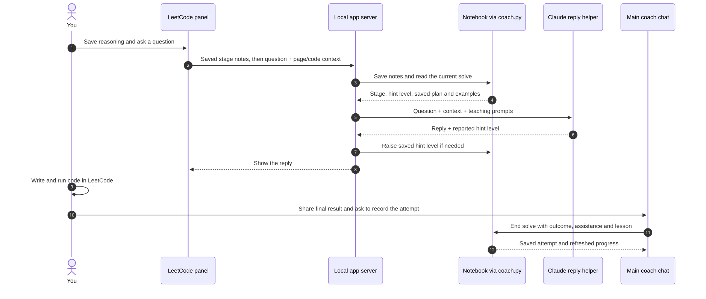

# DSA Coach: how the current setup works

Read against the repository on 2026-11-08, skill version 0.7.0. This describes the implementation; it is not a proposed redesign. No teaching rules or application code were changed for this walkthrough.

The central idea is: **the AI teaches, Python keeps the learning record, and the notebook carries your progress between sessions.** Several screens sit around that core, with different capabilities.

## 1. The overall picture

[Editable diagram](dsa-coach-overview.mmd)

Solid arrows show requests, saved work or information moving between pieces. Dotted arrows show teaching instructions. The diagram groups optional screens together; the table below separates them.

## 2. Each piece in everyday language

| Piece | What it does | Where it lives |
|---|---|---|
| Teaching guide | Tells the coach how to teach: attempt first, four solve stages (Understand, Find an approach, Build it, Check and finish), gradual hints, predictions, delayed recall, and logging. This is written guidance the AI must follow. | `skills/dsa-coach/SKILL.md`, `references/` |
| Course plan | Supplies topic order, problem lists, resources, and starting templates. | `skills/dsa-coach/assets/roadmap.json`, `problems.json`, `templates/` |
| Record keeper | Starts and ends solves, stores answers and hint levels, schedules reviews, selects practice, and calculates progress. It does not generate teaching replies. | `skills/dsa-coach/scripts/coach.py` |
| Notebook | Keeps your actual work and history as local files. | `notebook/` |
| Main coach chat | Reads the guide and your state, teaches, checks evidence, and uses commands to record learning. Its tools depend on where the chat runs. | Claude Code, Codex, or another supported host |
| Study app | Shows the topic map, Learn pages, and Solve workspace. You can save stage answers, edit local Python, and run examples. Normal Solve coaching prompts are copied into your main chat. | `app/static/` |
| Local app server | Handles the screens' requests. Calls `coach.py` for progress and session changes; also saves code/statements directly, runs local examples, fetches statements, and starts Claude jobs. | `app/server.py` and helper files |
| LeetCode extension | Opens a compact version of the app beside LeetCode and supplies editor/page context to its coach conversation. Requires the local server. | `extensions/dsa-coach/`, `app/static/companion.js` |
| Claude pane | Shows stage, timer, hints and due items inside Claude Code. Reads notebook files and sends button prompts into the chat. Does not need the study-app server. | `plugins/dsa-coach-pane/` |

The app server normally listens at `127.0.0.1:8765` on your computer. It tries later ports if that one is occupied. The core record keeper works without network access; AI replies and statement fetching use external services.

## 3. The three ways AI is used

These are separate jobs with different instructions and abilities.

| AI path | Receives | Can do |
|---|---|---|
| Main coach chat | Full skill, conversation, and notebook access when supported | Teach, inspect/run work with available tools, and log the completed attempt |
| LeetCode reply helper | A custom coach prompt, the four-stage prompt table and its teaching moves, current solve, saved plan/examples, recent panel conversation, and captured page/code/image context | Return feedback and a reported hint level. Tools are disabled; it cannot run code or complete the learning record. The server records a higher hint level. |
| Explainer writer | A request to use the skill and create/revise an interactive page | Read/write files, execute Python through allowed tools, save HTML, and register the explainer |

The two app helpers invoke the locally installed Claude CLI. They use separate job queues, each allowing one running job at a time. They are not the ongoing main-chat conversation.

## 4. What happens during practice

1. **Recover context.** `status` reads history and rebuilds the progress reports. A live solve remembers the current problem, stage, notes, hint level and focus blocks.
2. **Choose work.** By default, `next` prioritizes pending web imports, then due re-solves, then due cards, then a new problem. Choosing a named pattern explicitly skips that due-work priority.
3. **Begin.** `solve start` creates a local attempt file and saves the active solve. Only one solve is active in a notebook.
4. **Think and write.** You work through four stages: Understand, Find an approach, Build it, Check and finish. **Help me think** asks the coach for one question for the stage you're in. Stage notes and activity update the saved solve. Quiet time pauses the active-time clock.
5. **Check your code.** In the study app, `runner.py` executes your local attempt against its saved examples, with a time limit. In LeetCode, you run LeetCode's tests yourself. Passing examples alone does not automatically mark a problem retained or ready.
6. **Record the result.** The main coach calls `solve end` with the outcome, help used and lesson. In the LeetCode panel you can also finish there: the panel's coach reviews your evidence, and **Save attempt** calls `solve end` with the reviewed record. Either way this logs the attempt, archives stage notes, clears the active solve, and refreshes progress. A repeated end returns the attempt already logged. The app can also park a solve as partial.
7. **Return later.** Saved attempts determine review dates and evidence of retention. A delayed unaided solve is what earns retention credit; simply finishing a page or receiving a good explanation does not.

The LeetCode path makes the final handoff especially visible:

[Editable flow](dsa-coach-browser-flow.mmd)

## 5. What is remembered, and where

| Information | Stored where | Meaning |
|---|---|---|
| Current stage, notes, hints, timing | `notebook/sessions/current.json` | Resume the current solve across chats and screens |
| Local code, plan card and examples | `notebook/problems/<problem>/<attempt>.py` | The study app edits this real file; the plan is in its opening text and examples are in `EXAMPLES` |
| Problem statement and lasting notes | `notebook/problems/<problem>/` | Readable reference material and archived lessons |
| Completed attempts and questions | `notebook/learner/attempts.jsonl`, `questions.jsonl` | Learning history used to calculate progress |
| Recall cards and their schedules | `notebook/learner/cards.json` | Separate review items; drafts need approval |
| Saved interactive explainers | `notebook/concepts/` plus `artifacts/registry.json` | HTML pages and a list of where to find them |
| Journey and teaching-technique reports | `JOURNEY.md`, `journey.json`, `learner/summary.md`, `learner/techniques.json` | Rebuilt from saved records; not independent progress databases |
| Unsaved app drafts | Browser storage | Recovery help in that browser/origin; not a notebook save or learning credit |
| Panel conversation and captures | Temporary panel/server memory | Not a durable notebook transcript; reloading the panel starts fresh |
| LeetCode editor code | LeetCode's editor; captured for questions | Not automatically copied into the local attempt file |

For problems, the default review intervals are 1, 3, 7, 14 and 30 days, based on consecutive unaided solves and capped as the target date approaches. Retention normally requires an unaided solve at least three days after first exposure. The script calculates these labels from the inputs recorded by the coach; it still depends on those inputs being accurate.

## 6. Moving between tools and machines

- **Local chats:** `.agents/skills/` and `.claude/skills/` point at the same skill. Project instructions tell the agent how to use this workspace.
- **Claude automation:** `.claude/settings.json` refreshes status at session start, records activity on prompts, and blocks supported editing tools from writing the active problem's Python files below hint level 7. Other hosts rely on the coaching instructions unless an equivalent hook exists.
- **Web chats:** export a context pack → attach it to the chat → bring back a structured session-update file → save it in `notebook/inbox/` → import through `coach.py`. This is a manual round trip, not live synchronization.
- **Skill ZIP:** `coach.py package` includes the skill folder. It does not include the notebook, study app, extension or pane.
- **Git:** keeps version history and can move committed work between machines. Notebook updates do not automatically commit or push themselves.

## 7. Checks and planned pieces

The repository has Python tests for the record keeper and app helpers, JavaScript tests for screen behavior, browser checks for the map and extension, and pane tests. `coach.py validate` checks skill/notebook structure. This walkthrough inspected those boundaries but did not run the full test suites or exercise a live Claude/LeetCode session.

The reusable trace recorder/renderer library, automated coaching-behavior evaluations, specialist visualizer/curator agents, and a live web-notebook connection remain planned in `ARCHITECTURE.md`. Existing explainers are individual generated pages, and the app already has an explainer-writing path.

## 8. Questions for the improvement discussion

These are discussion points grounded in the current wiring, not a completed bug audit:

1. **Completing a solve:** should a LeetCode practice session be recordable entirely from its panel? Today completion moves to the main chat.
2. **Continuity:** which feedback, questions and LeetCode code should survive a panel reload or move into another chat? Today only selected structured information is durable.
3. **Teaching consistency:** how much guidance should the panel share with the main coach? Today it gets a custom prompt and the stage table, not the complete skill and learner history.
4. **Keeping rules aligned:** stage names, timer behavior, and coaching prompts appear in multiple Python, JavaScript, TypeScript and Markdown files. Which should have one shared definition?
5. **Proving learning:** how should we test whether replies respect the hint ladder and whether changes improve delayed independent solves? Software tests and the learning ledger cover different parts of this question.

Start with the completion handoff: trace one real session from selecting a problem to the next review being scheduled, and decide what should happen without switching screens.

## Source map

- Teaching: [skill](../skills/dsa-coach/SKILL.md), [learning record rules](../skills/dsa-coach/references/learner-model.md), [platforms](../skills/dsa-coach/references/platforms.md).
- Records and scheduling: [coach.py](../skills/dsa-coach/scripts/coach.py), [session locking](../skills/dsa-coach/scripts/session_lock.py).
- App: [server](../app/server.py), [attempt editing](../app/attempt_file.py), [test runner](../app/runner.py), [statement fetching](../app/statement.py).
- AI helpers: [reply prompt and tool limits](../app/companion.py), [background jobs](../app/claude_job.py).
- Screens: [study app](../app/static/app.js), [map and Learn](../app/static/nav.js), [panel conversation](../app/static/companion.js), [extension](../extensions/dsa-coach/sidepanel.js), [Claude pane](../plugins/dsa-coach-pane/hooks/register.tsx).
- Existing design and rationale: [architecture](../ARCHITECTURE.md), [research](research/dsa-learning-skill-research.md), [learning principles](research/learning-principles.md).
